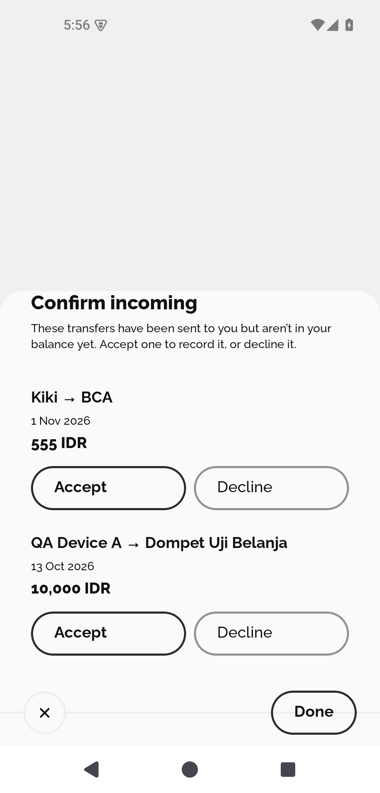
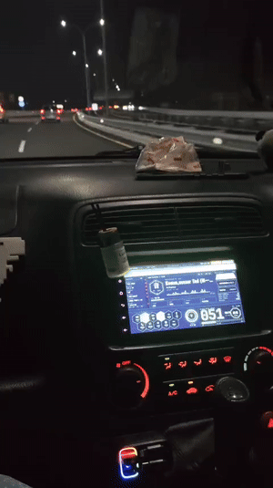
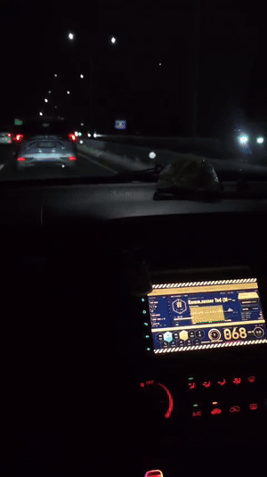

# Lily: I hated my car's infotainment screen, so I replaced it

My car has a Chinese-made Android head unit (NWD K2501, Allwinner T507, Android 10, 1024x600). It works, but I hated how its stock home screen looked every single time I got in. So I built my own: **a native Android launcher that replaces it**, drawn in the visual language of Neon Genesis Evangelion's NERV terminal interface.

## Before vs After

| Before: stock home screen | After: Lily (NGE terminal) |
|---|---|
|  |  |

*Left: the head unit's stock launcher. Right: Lily rendering the NGE terminal interface on the unit (1024x600, 160 dpi).*

## Screenshots

All captures are from the real K2501 head unit (1024×600) or the 1024×600 emulator.

| Normal (day) |
|---|
|  |

*Captured on the 1024×600 emulator at 160 dpi. Speed zones (caution/emergency) can be tested with the long-press threshold dialog (long-press anywhere → set thresholds to 1/2 km/h).*

### Animations (GIF demos)

| Caution zone | Emergency zone |
|---|---|
|  |  |

*GIF demos of the caution and emergency fullscreen warning overlay animations (hazard stripes, ticker scroll, pulsing center box).*

## What it does

- **Now playing is the main thing:** Bluetooth song and artist, FM station and frequency, or the USB track, with an animated tape deck that only moves while music plays.
- **BT / RADIO / USB keys switch the source and start playing in place**, with no app opening. Prev / Play / Next / Seek work for each source.
- **Phone:** shows the connected phone and opens the stock phone app to call or switch phones.
- **Android Auto / CarPlay** (via the unit's zlink app) opens by itself when the phone connects.
- **Starts the music when the phone connects** (can be turned off in Home settings).
- **Speed-aware palette:** green below 60 km/h, yellow (caution) 60-100 km/h, red (emergency) above 100 km/h. Hazard stripes, a scrolling ticker, and a pulsing fullscreen warning overlay activate in caution/emergency zones. Thresholds configurable.
- **Day/night mode:** time-based (17:00 night, 05:00 morning), toggleable AUTO/MANUAL. Headlight override if available.
- **Volume knob** that follows your finger and shows the real stereo volume.
- **MAGI system:** three trapezoid indicators (Melchior/Balthasar/Casper) mapping to BT/RADIO/USB, with inverted middle node.
- **More sheet:** 15 tiles (Radio, USB Music, Video, Dashcam, Sound EQ, AUX, Files, Car, CAN, Wheel keys, Android, Screen off, Home setup, Magisk, Restart).
- **NERV aesthetic:** zero glow (flat solid fill), Shippori Mincho B1 for Japanese kanji, Oswald (condensed) for Latin caps, Saira Extra Condensed for warning stamps, JetBrains Mono for numerals, hexagonal geometry, bilingual JP/EN text, honeycomb background (A.T. Field).

## How it works

The unit's only WebView is from 2019, so it can't render the mockup's CSS. Instead of a WebView app:

1. The design lives in `mockup/nge-terminal-deepseek-v4.html` (the canonical mockup), which you can open in any browser. It has a simulator panel to fake signals (phone plugged in, reverse gear, headlights, speed...).
2. The Kotlin app draws the NGE terminal interface directly on `View + Canvas` - no baked images, no WebView, no AndroidX, no libraries. Colors are driven by a speed-zone palette enum (green/yellow/red). All geometry comes from `Nge.kt` constants.
3. It talks to the head unit the way the stock launcher does: broadcasts, `Settings.System` values, and two vendor AIDL services called with raw binder transactions. See [docs/INTEGRATION.md](docs/INTEGRATION.md).

## Repo layout

```
mockup/     the design: nge-terminal-deepseek-v4.html (canonical) + fonts (open in a browser)
launcher/   Android project (Kotlin), install / rollback scripts
eq/         optional audio tune for the unit's AK7602 DSP (see warnings)
docs/       design brief, EGM design doc, integration notes, test plan, screenshots
```

## Build

Needs JDK 17 and the Android SDK (platform 34). Put `sdk.dir=/path/to/Android/sdk` in `launcher/local.properties`, or set `ANDROID_HOME`.

```sh
cd launcher
./gradlew assembleRelease        # app/build/outputs/apk/release/app-release.apk (debug-signed)
```

Fonts are bundled in `launcher/app/src/main/assets/fonts/`: Oswald, Shippori Mincho B1, Saira Extra Condensed, JetBrains Mono (all OFL-licensed).

## Install on a head unit - read this first

This is **experimental software for one specific device and firmware**. It needs root ADB over Wi-Fi and changes system settings. I only tested it on my own NWD K2501 (Android 10). Use it at your own risk, and nothing here is meant to be used while driving.

```sh
cd launcher
UNIT=192.168.1.50:5555 ./scripts/install.sh     # build, install, make it the default Home
UNIT=192.168.1.50:5555 ./scripts/rollback.sh    # stock launcher back as Home
```

What `install.sh` changes: installs the app; grants it the `SYSTEM_ALERT_WINDOW` app-op and `READ_LOGS`; and sets the system property `persist.nwd.launcher.default` (NWD's firmware picks the Home app from it and ignores Android's normal setting). While running, the app also sets the LCD contrast and saturation by writing to the display's files under `/sys/devices/virtual/disp/` (65 by day, the factory 50 at night), which only works with root. The stock launcher is **never disabled**: its services keep running and `rollback.sh` restores everything. If Lily ever misbehaves and the screen is unusable, from a computer run `adb shell setprop persist.nwd.launcher.default com.android.launcher` (or `adb uninstall com.lily.launcher`).

**`eq/` is riskier:** `apply.sh` overwrites the stock DSP settings file and locks its folder read-only. The values are tuned for my car and speakers (speaker delays, bass boost). Try them at low volume, keep `eq/original.xml` to undo, and don't expect them to suit another car.

## Known issues

Tested on the NWD K2501 head unit (Android 10, 1024x600). The following are known limitations:

- **Auto day/night cycle** - fixed in latest build (clock tick now re-evaluates time-based switching). Previously only worked on manual toggle.
- **Night brightness** - LCD contrast/saturation set to 40 at night (was 50). May still be too bright for some; adjustable via `PANEL_DAY` constant in `Car.kt`.
- **Android Auto / CarPlay reopen** - pressing Home and then AUTO hex should now bring zlink back to foreground (added `REORDER_TO_FRONT`). If it still doesn't reopen, the zlink app may need to be restarted.
- **Play/Pause delay** - 1-2 second delay when pressing Play/Pause is a vendor AIDL service limitation, not a launcher bug. The launcher sends the command immediately; the vendor BT service processes it with delay.
- **CarPlay "No title"** - when CarPlay is active, audio metadata (title/artist) is not recognized by the launcher. The music plays correctly, but the launcher shows "No title". This is because CarPlay audio goes through a different path (zlink app) that the launcher doesn't monitor. Fix would require monitoring zlink's audio broadcasts.
- **Music playback choppiness** - occasional choppiness during Bluetooth/Android Auto playback is a Bluetooth/AA issue, not a launcher issue.
- **GPS speed** - works correctly on the head unit. Emulator has no GPS speed simulation.

## Privacy and permissions

- **No internet permission.** The app can't send anything off the unit, and it stores only a few settings and the last source in its own private preferences.
- `READ_LOGS` is used for one thing: reading the Bluetooth daemon's log tag (`nwdbt`) to get a song's length, which the stock Bluetooth app doesn't pass on. It is filtered to that tag and nothing is saved.
- `SYSTEM_ALERT_WINDOW` lets it start Android Auto while another app is in front.
- `ACCESS_FINE_LOCATION` is used for vehicle speed (GPS), stored in memory only, never logged to disk.

## Credits

- **Design inspiration:** [NERV UI](https://github.com/TheGreatGildo/nerv-ui) - NERV Operations Console design system (MIT). [idrive7-EVAHUD](https://github.com/PenguinDukeYDAuto/idrive7-EVAHUD) - EVA HUD for BMW iDrive 7 (MIT).
- **Upstream launcher:** forked from an open-source Android launcher (MIT).
- **Visual style:** Neon Genesis Evangelion (khara) - NERV terminal interface design language.
- **Fonts:** Oswald, Shippori Mincho B1, Saira Extra Condensed, JetBrains Mono (all SIL OFL 1.1).
- **Trailer music:** "Happy Beats / Business Moves" by [ende.app](https://ende.app) (CC BY 4.0). Sound effects from [Kenney](https://kenney.nl) (CC0). Made with [Hyperframes](https://hyperframes.heygen.com/).

## Legal and credits

- Not affiliated with or endorsed by NWD, zlink, Google, khara, or Teenage Engineering. Product names belong to their owners. The look is *inspired by* Neon Genesis Evangelion's NERV terminal interface; no EVA artwork or fonts are used beyond OFL-licensed typefaces.
- The "Before" image is a screenshot of the head unit's stock launcher, shown only for comparison. Its artwork belongs to the vendor.
- **No vendor code or firmware is included.** Action strings, setting names and AIDL transaction numbers were found by observing the unit's own apps, for interoperability, and are listed in `docs/INTEGRATION.md`. `MusicBean.kt` is a small reimplementation of a data class's wire format, needed to read the USB player's broadcasts.
- Fonts: [Oswald](https://fonts.google.com/specimen/Oswald) (SIL OFL 1.1) is the Latin condensed grotesque, [Shippori Mincho B1](https://fonts.google.com/specimen/Shippori+Mincho+B1) (SIL OFL 1.1) the Mincho face for Japanese, [Saira Extra Condensed](https://fonts.google.com/specimen/Saira+Extra+Condensed) (SIL OFL 1.1) for warning stamps, and [JetBrains Mono](https://www.jetbrains.com/lp/mono/) (SIL OFL 1.1) the monospace. Licences are in `launcher/app/src/main/assets/fonts/`.
- Trailer: music is "Happy Beats / Business Moves" by [ende.app](https://ende.app) (CC BY 4.0); sound effects are from [Kenney](https://kenney.nl) (CC0). Made with [Hyperframes](https://hyperframes.heygen.com/).
- Code: [MIT](LICENSE).